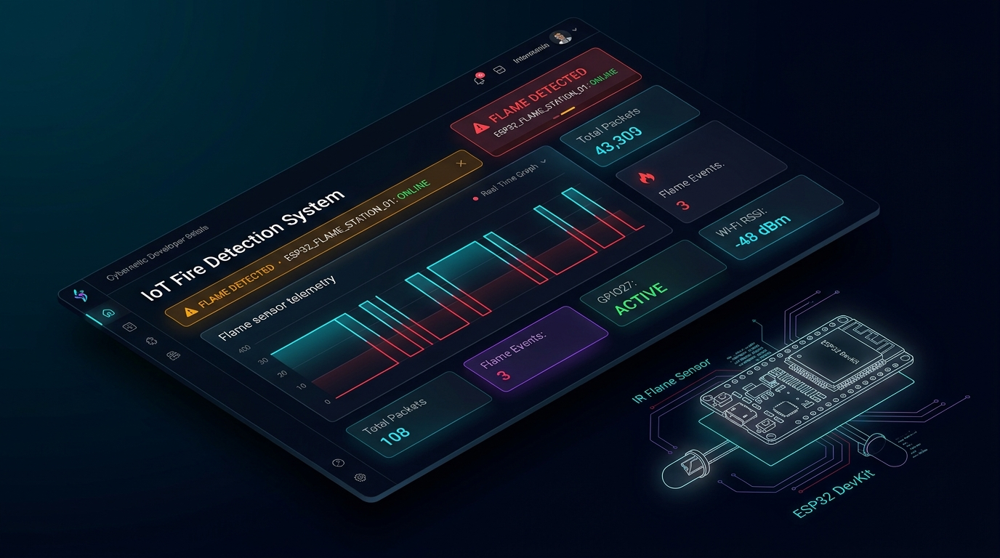
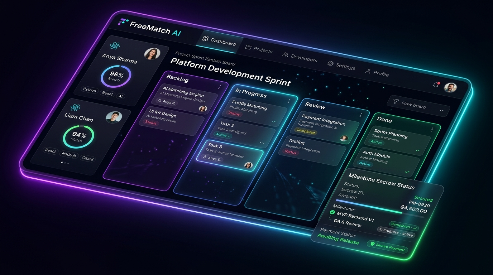
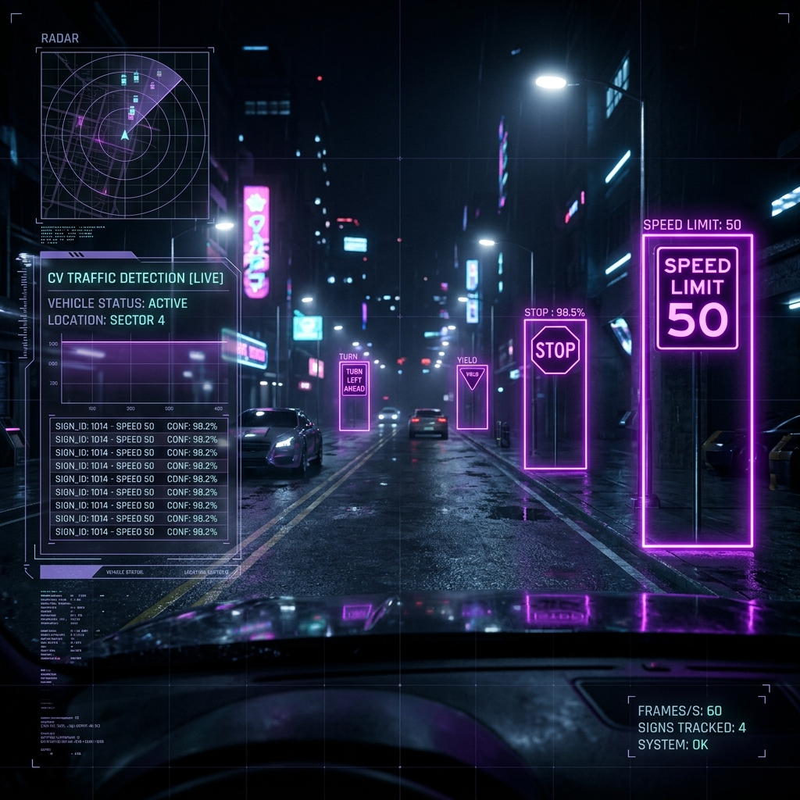
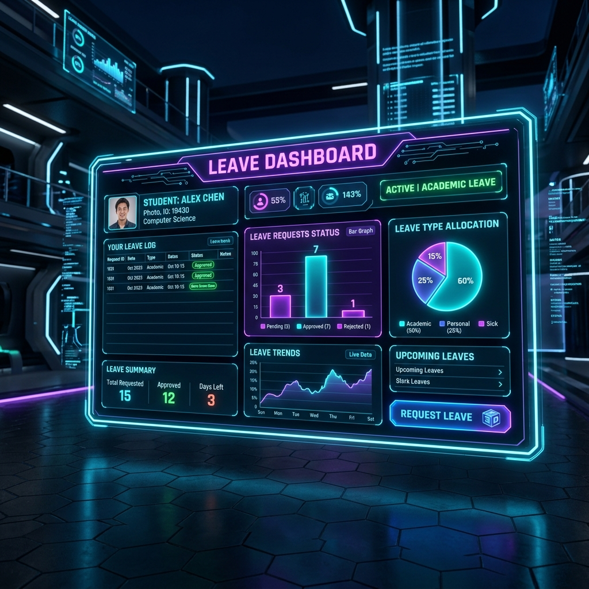
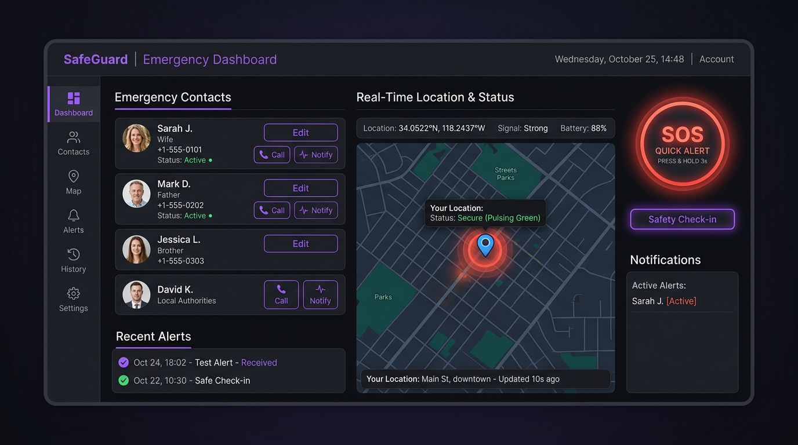
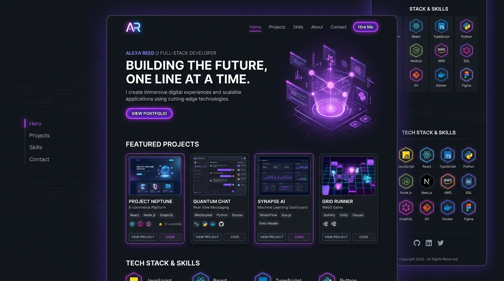

# Abhilash K K — Interactive Portfolio & Resume Website

A dark-themed, interactive developer portfolio and resume web application built with **React**, **Vite**, and **Tailwind CSS v4**. Designed as a single-page application (SPA) and deployed on **GitHub Pages**, it presents Abhilash K K's professional summary, featured projects, internship experience, academic journey, skills, verified certifications, downloadable PDF resume, and contact channels.

---

## Live Website

**Live Portfolio:** [https://abhilash-kk.github.io/Portfolio_abhilash/](https://abhilash-kk.github.io/Portfolio_abhilash/)

---

## Features

- **Interactive Background & Theme Customizer**
  - Switch between four accent color themes (`Purple`, `Green`, `Blue`, `Red`) persisted via `localStorage` and CSS custom properties.
  - Toggle the full-screen canvas background between a mouse-reactive **Neural Network** particle simulation and **Matrix Digital Rain** mode.
- **Web Audio Sound Effects**
  - Synthesized UI sound effects for clicks, hovers, keyboard typing, physics ticks, and command success using the browser Web Audio API, with a persistent mute/unmute toggle.
- **In-Browser Resume Preview & Download**
  - View `public/resume.pdf` directly inside a modal iframe viewer (`ResumeModal`) with a fullscreen option and animated download trigger (`Abhilash_KK_Resume.pdf`).
- **Interactive Diagnostics Terminal & Live GitHub Stream**
  - Built-in terminal emulator (`TerminalWidget`) supporting `help`, `skills`, `projects`, `contact`, `matrix`, and `clear` commands.
  - Live GitHub activity feed (`GithubStream`) powered by the GitHub REST API with a 20-week SVG contribution graph and automatic fallback data if rate-limited.
- **Featured Projects Showcase**
  - Interactive 3D tilt cards with glare effects (`Tilt`) and detail modals showcasing key accomplishments, tech stacks, live app links, and GitHub repository links:
    - **IoT Fire Detection System** — ESP32, FastAPI, PostgreSQL & React Real-Time Telemetry Dashboard
    - **FreeMatch AI** — AI-Assisted Freelance Marketplace Platform
    - **Traffic Sign Detection and Recognition** — YOLO & Deep Learning System
    - **Student & Employee Leave Management Hub** — Django & MySQL Web Portal
    - **Emergency Contact & Real-Time Alert System** — React & Geolocation Web App
    - **Interactive Developer Portfolio** — This portfolio showcase app
- **Scroll-Animated Experience Timeline & Certificate Viewer**
  - Vertical SVG scroll-progress timeline for internship roles (`M-Squared Software & Services (P) Ltd` and `Geek Wick TechMedia Services Pvt Ltd`) with modal certificate previews and official PDF downloads.
  - Interactive courses and certifications grid (Smart India Hackathon 2025, NPTEL ML, NASA Space Apps with multi-certificate tab switcher, NPTEL Blockchain, and I2U 2025).
- **Skills Overview & Physics Sandbox**
  - Skill proficiency progress bars, categorized badges (`Databases & Tools`, `Core Competencies`, `Languages`), and a draggable HTML5 Canvas physics bubble sandbox (`SkillsSandbox`) supporting mouse and touch interactions.
- **Contact Form & Direct Links**
  - Contact form integrated with the FormSubmit AJAX endpoint alongside direct phone, WhatsApp, email, and social profile links.

---

## Technology Stack

- **Frontend Library:** React (`19.2.7`), React DOM (`19.2.7`)
- **Language:** JavaScript (ES6+), HTML5, CSS3
- **Styling & Typography:** Tailwind CSS v4 (`@tailwindcss/vite`), Google Fonts (`Outfit`, `Space Grotesk`), Font Awesome (`6.4.0` CDN)
- **Build & Deployment Tools:** Vite (`8.1.0`), `@vitejs/plugin-react`, Oxlint (`1.69.0`), `gh-pages`
- **Browser & External APIs:**
  - HTML5 Canvas 2D API (particle network, matrix rain, physics bubble sandbox)
  - Web Audio API (procedural sound effects)
  - Intersection Observer API (scroll reveal animations)
  - `localStorage` (theme, background mode, and audio mute persistence)
  - GitHub REST API (`https://api.github.com/users/Abhilash-KK/events`)
  - FormSubmit AJAX API (`https://formsubmit.co`)

---

## Installation & Setup

### Prerequisites

- **Node.js** (v18+ recommended) and **npm**

### Local Development

1. **Clone the repository:**
   ```bash
   git clone https://github.com/Abhilash-KK/Portfolio_abhilash.git
   cd Portfolio_abhilash
   ```

2. **Install dependencies:**
   ```bash
   npm install
   ```

3. **Start the development server:**
   ```bash
   npm run dev
   ```
   > **Note:** Because `vite.config.js` configures `base: '/Portfolio_abhilash/'` for GitHub Pages, the local dev server serves the app at `http://localhost:5173/Portfolio_abhilash/`.

### Available Scripts

| Command | Description |
| :--- | :--- |
| `npm run dev` | Starts the local Vite development server with HMR. |
| `npm run build` | Builds the production bundle into the `dist/` directory. |
| `npm run preview` | Previews the production build locally. |
| `npm run lint` | Runs `oxlint` across the codebase. |
| `npm run deploy` | Builds (`predeploy`) and deploys `dist/` to GitHub Pages via `gh-pages`. |

---

## Project Structure

```text
resume-website/
├── public/                        # Static assets copied directly to dist/
│   ├── certificates/              # Certificate PNG previews and official PDFs
│   ├── hero_neural_net.png        # Hero section neural network graphic
│   ├── proj_fire_detection.jpg    # IoT Fire Detection System project preview visual
│   ├── proj_freematch.jpg         # FreeMatch AI project preview visual
│   ├── proj_tsrd.png              # Traffic Sign Detection project preview visual
│   ├── proj_leave_hub.png         # Leave Management Hub project preview visual
│   ├── proj_emergency_contact.png # Emergency Contact App project preview visual
│   ├── proj_portfolio.png         # Developer Portfolio project preview visual
│   └── resume.pdf                 # Resume PDF displayed & downloaded in ResumeModal
├── src/
│   ├── assets/                    # Bundled starter SVG/PNG assets
│   ├── components/
│   │   ├── About.jsx              # Summary, key strengths, terminal, & GitHub stream
│   │   ├── Certificates.jsx       # Courses & certifications grid + viewer modal
│   │   ├── ContactForm.jsx        # Contact form (FormSubmit) & direct contact details
│   │   ├── Education.jsx          # Academic journey cards (MCA, BCA, Plus Two, SSLC)
│   │   ├── Experience.jsx         # Scroll-driven timeline & internship certificate modal
│   │   ├── Footer.jsx             # Footer copyright & social links
│   │   ├── GithubStream.jsx       # GitHub activity log & 20-week contribution grid
│   │   ├── Hero.jsx               # Hero banner & Resume modal trigger
│   │   ├── InteractiveCanvas.jsx  # Neural network & Matrix rain background canvas
│   │   ├── Navbar.jsx             # Fixed navbar, theme switcher, SFX & BG toggles
│   │   ├── Projects.jsx           # Project showcase cards & detail modal
│   │   ├── ResumeModal.jsx        # Embedded PDF preview modal with download progress
│   │   ├── ScrollReveal.jsx       # Intersection Observer scroll-reveal wrapper
│   │   ├── Skills.jsx             # Skill bars, tools, competencies, & languages
│   │   ├── SkillsSandbox.jsx      # Draggable HTML5 Canvas physics skill bubbles
│   │   ├── TerminalWidget.jsx     # Interactive diagnostics command shell
│   │   └── Tilt.jsx               # 3D mouse-tilt card with glare effect
│   ├── utils/
│   │   └── sfx.js                 # Web Audio API sound synthesizer & mute state
│   ├── App.jsx                    # Root layout assembling all portfolio sections
│   ├── index.css                  # Tailwind CSS v4 imports & theme CSS variables
│   └── main.jsx                   # React root mount entry point
├── .oxlintrc.json                 # Oxlint rules configuration
├── index.html                     # HTML entry point, Google Fonts & Font Awesome CDN
├── package.json                   # Project dependencies & npm scripts
└── vite.config.js                 # Vite config with React, Tailwind, and GH Pages base
```

---

## Project Visual Previews

The repository includes the following project showcase visuals in `public/` used across the portfolio cards:

| IoT Fire Detection System | FreeMatch AI |
| :---: | :---: |
|  |  |

| Traffic Sign Detection | Leave Management Hub |
| :---: | :---: |
|  |  |

| Emergency Contact App | Developer Portfolio |
| :---: | :---: |
|  |  |

---

## Author

**Abhilash K K**

- **Location:** Ambalavayal, Wayanad, Kerala, India
- **Email:** [kkabhilash30@gmail.com](mailto:kkabhilash30@gmail.com)
- **GitHub:** [https://github.com/Abhilash-KK](https://github.com/Abhilash-KK)
- **LinkedIn:** [https://www.linkedin.com/in/abhilash-kk/](https://www.linkedin.com/in/abhilash-kk/)
- **Portfolio:** [https://abhilash-kk.github.io/Portfolio_abhilash/](https://abhilash-kk.github.io/Portfolio_abhilash/)
